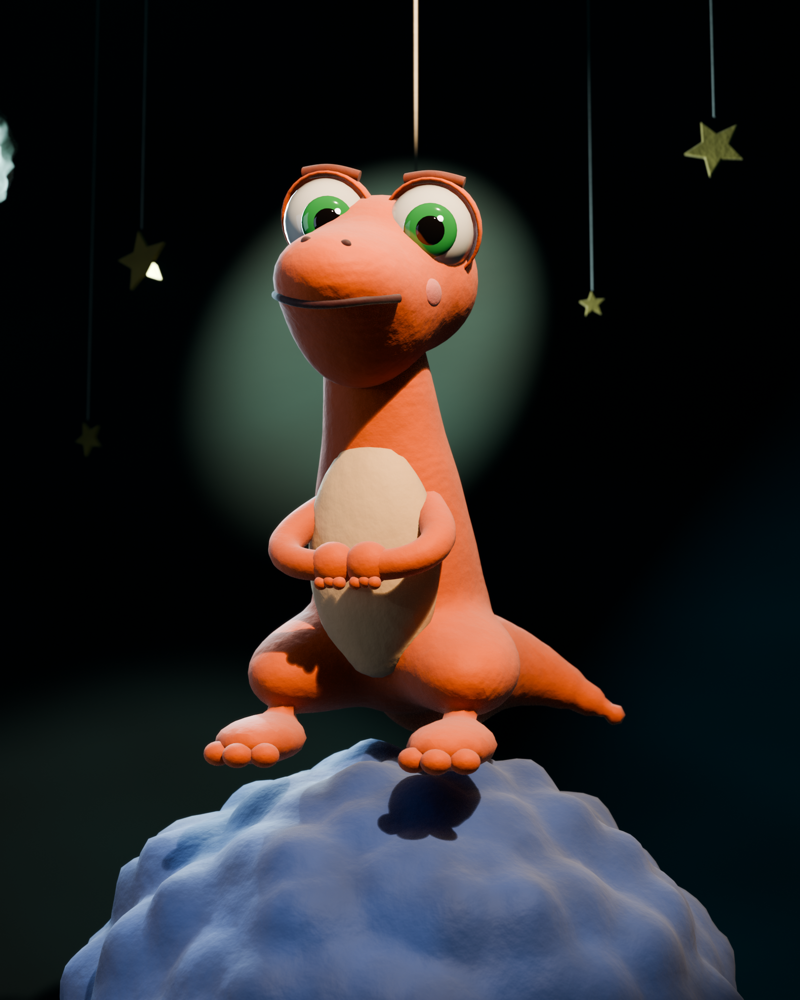

# ¿Nos va a caer un asteroide?

Presentación interactiva de un modelo de machine learning que clasifica asteroides
potencialmente peligrosos (PHA) con datos de la NASA / JPL. Proyecto de Introducción a la
Inteligencia Artificial (6.º semestre).

Estilo stop motion de plastilina: un dino sobre la Tierra, 30 pasos que salen de asteroides
que se abren como geodas, gráficas hechas a mano y una cinemática final.



## Equipo

- Dylan Alexander Mejia Ceballos
- Luis Miguel Brito Rincon
- Gabriel Alejandro Giraldo Ayerbe
- Juan Pablo Muñoz Corchos
- Juan Pablo Agudelo
- Evelyn Gómez Aristizabal

## Cómo verla

```bash
npm install
npm run dev
```

La portada (`/`) deja elegir entre dos versiones con la misma escena:

- **`/expo`**: la exposición de clase, 11 pasos (~10 minutos), con una cinemática distinta en cada asteroide.
- **`/proyecto`**: el proyecto completo, 30 pasos.

Se navega con las flechas, los botones, tocando un asteroide o deslizando en tablet. Las geodas
del piso explican los términos (MOID, H, PR-AUC, F2).

## Estructura

- `src/presentacion/`: guion de las 30 diapositivas, navegación y contenido.
- `src/escena/`: escena 3D con React Three Fiber (dino, asteroides, Tierra, cinemática).
- `src/ui/` y `src/graficas/`: panel de papel, controles y gráficas en SVG.
- `resultados/`: métricas y tablas exportadas por el notebook del modelo. Todas las cifras de la
  presentación salen de aquí.
- `public/modelos/`: modelos GLB del dino y los asteroides.
- `blender/`: archivos y scripts de Blender con los que se modelaron y exportaron.

## Tecnología

Vite, React, TypeScript, Tailwind CSS, Three.js / React Three Fiber y Blender.
